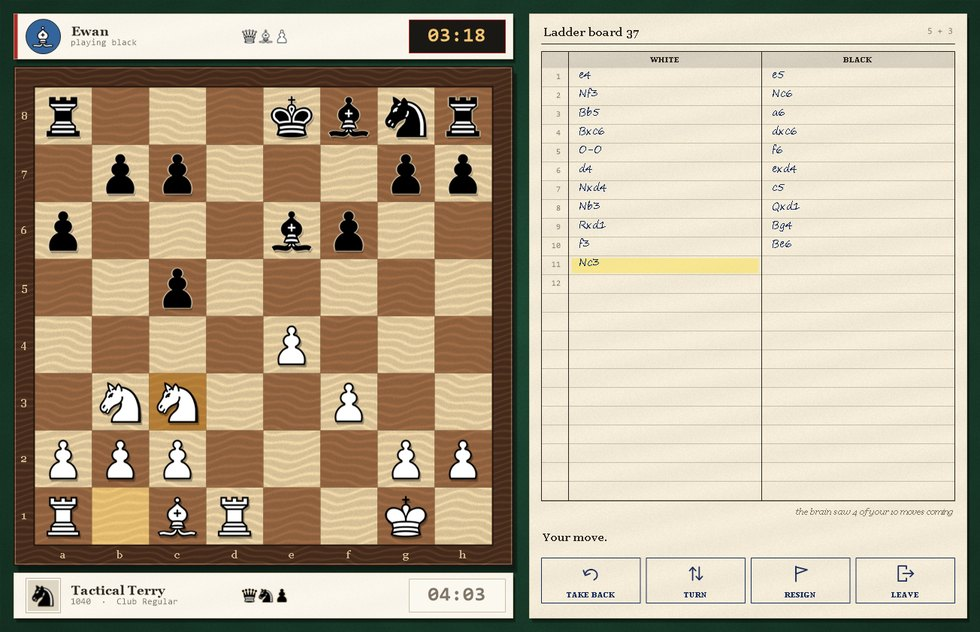
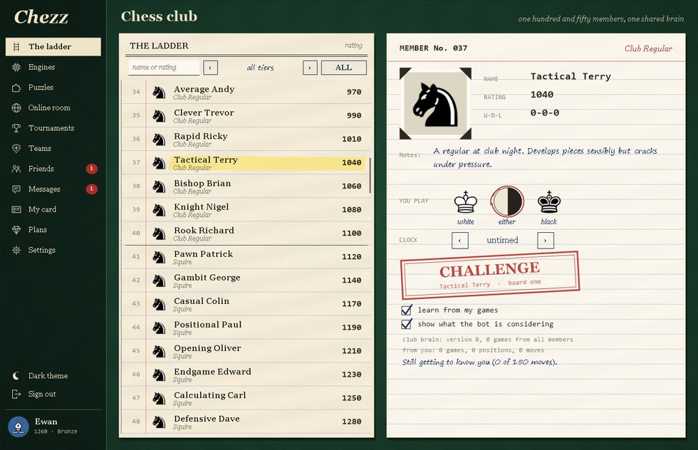
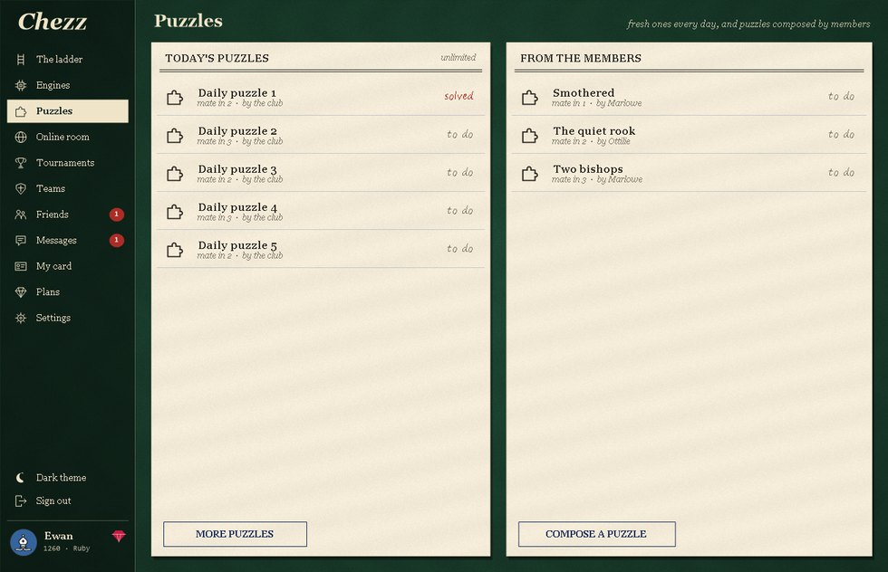
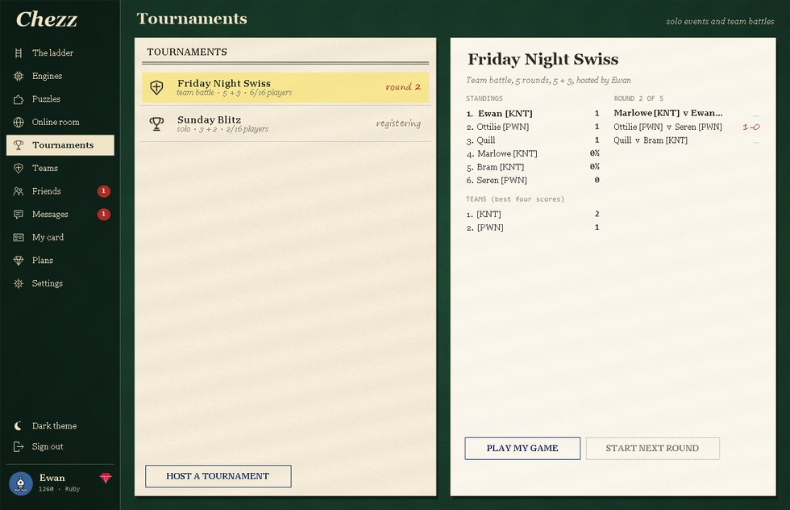
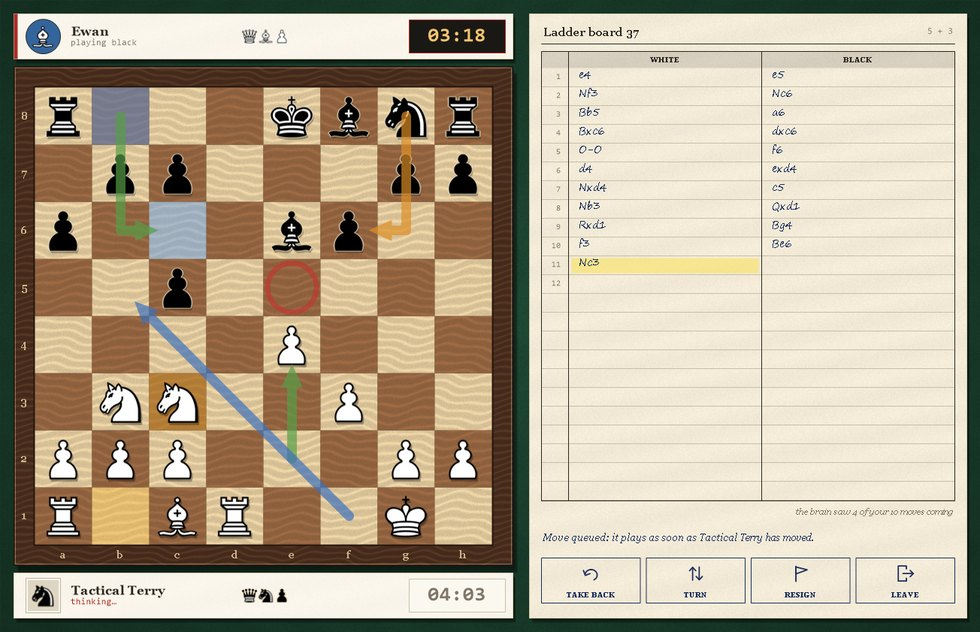
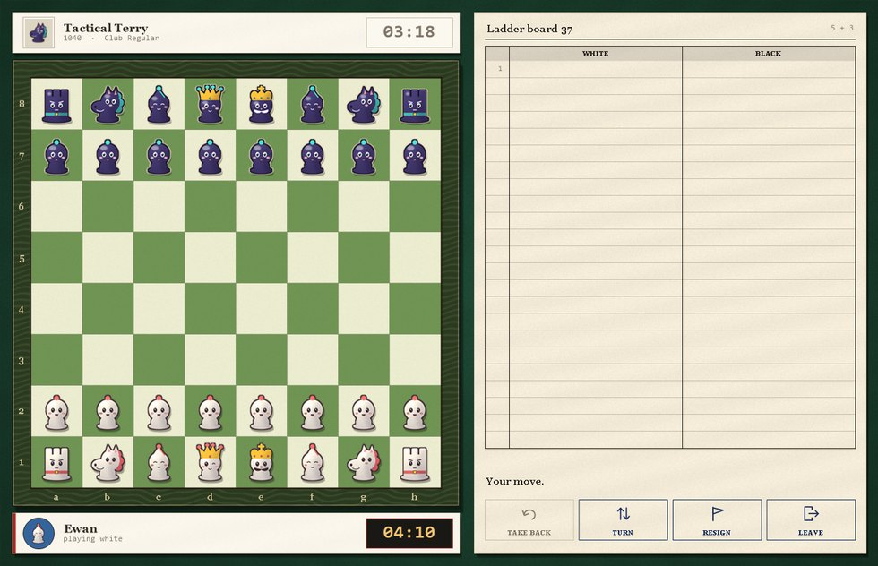
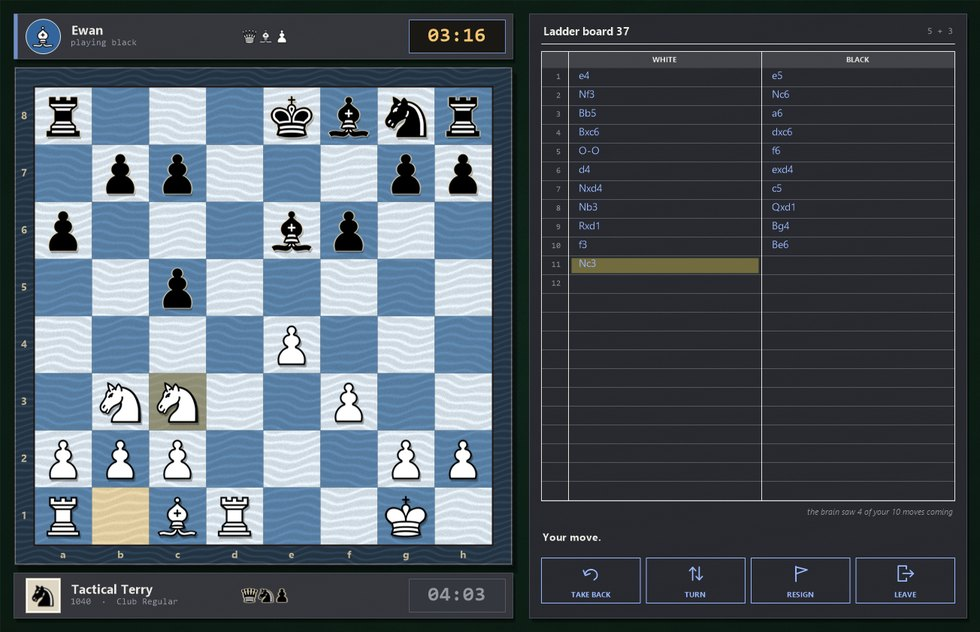
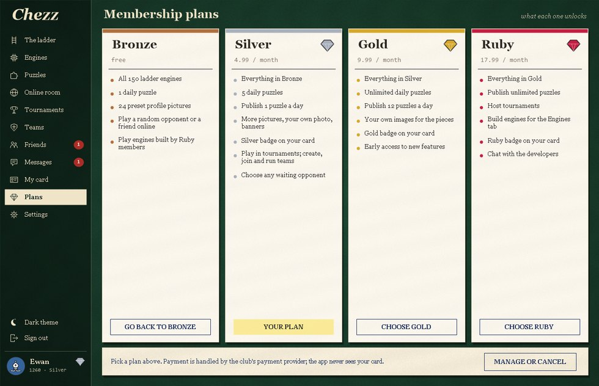

# Chezz

A chess club that fits in one file. Play 150 named engines, solve a fresh puzzle every day, sit down
with a friend online, run a tournament — and teach a neural network that every member shares.

Windows, C++17, Win32 and GDI+. No frameworks, no installer, no runtime to fetch.

**[Download Chezz.exe](../../releases/latest)** · about 6 MB · double-click and play



---

## What's in it

**150 opponents.** A ladder from 250 to 3500, each with a name, a portrait and a temperament. The
weak ones hang pieces like beginners; the strong ones punish you for it. Filter the list by name,
rating, tier, or whether you have beaten them yet.

**A brain that learns from you.** Behind every engine is one neural network — 768 inputs, five
hidden layers of 150 — that adds a learned correction to a hand-written evaluation. It trains on
every game you finish. A second model learns *your* habits from your own moves, so engines can
anticipate how you usually reply and steer towards lines where you tend to go wrong. The scoresheet
keeps score of that: *"the brain saw 4 of your 10 moves coming"*.

**The brain is shared.** It lives on the server, not on one computer. Sign in and you get the
club's newest version; finish a game and what you taught it goes back for everyone else.



**Play people.** Open a table for anyone or invite a friend, with clocks from 1+0 to 30+0. Add
friends, block people you'd rather not meet, and send private messages.

**Puzzles every day.** Mate in two or three, found by the engine in seeded practice games, so every
copy of the app produces the same puzzles on the same day without a server deciding anything.
Members can compose their own; the engine checks there really is a forced mate before publishing.



**Teams and tournaments.** Found a team, pick a tag, build a roster. Hosts announce Swiss events —
solo or team battle — and the app does the pairing, the byes, the standings and the result filing.



**Build your own engine.** Six dials — how far it looks ahead, how long it thinks, how often it
misjudges, how often it blunders, positional sense, aggression — and the app estimates its rating.
Anyone in the club can then challenge it.

**Plan your attack.** Right-drag to draw arrows on the board, right-click for a ring; knight moves
are drawn as an L. Hold Shift, Ctrl or Alt for other colours. Against an engine you can queue a
pre-move while it thinks.



**Make it yours.** Light, dark and high-contrast themes, accent and table colours, six font sets,
eight board schemes, four board textures, and four piece sets — classic, designer art, plain
letters, and a set of characters with faces.





## Playing

Download `Chezz.exe` and run it. Windows may warn about an unknown publisher, because the file is
not code-signed.

Chezz asks you to join the club first: an email and a password, which is what carries your rating,
your friends and your messages between machines. You can also sign the visitors' book and play
online as a guest. Everything personal lands in a `data` folder beside the exe, or in
`%LOCALAPPDATA%\Chezz` if that folder is read-only.

| | |
|---|---|
| Move | Click a piece and click a square, or drag it |
| Plan | Right-drag for an arrow, right-click for a ring, left-click to wipe them |
| Pre-move | Move while an engine is thinking; it plays the moment the engine has |
| Turn the board | `F` |
| Back | `Esc` |
| Browse the ladder | Arrow keys, `Enter` to challenge |

## Membership plans

Bronze is free: all 150 engines, a daily puzzle, and online games against a friend or a random
opponent. Silver, Gold and Ruby add more puzzles, publishing, teams and tournaments, custom
pictures and pieces, and engine building. The app opens your payment provider's page in a browser
and never sees a card.



## Building it

You need MinGW-w64 `g++` and `windres` on PATH
(`winget install BrechtSanders.WinLibs.POSIX.UCRT`).

```bat
build.bat
```

That produces one self-contained `Chezz.exe`. Everything under `assets\` — the four piece sets, the
sounds, the icon — is compiled into it, so the exe runs on its own in an empty folder. A loose file
in `assets\` still wins over the copy inside, which is how you try new artwork without rebuilding.

Tests run without opening a window, and `--data` keeps them away from your real folder:

```bat
Chezz.exe --data C:\Temp\chezztest --selftest           :: engine, brain, audio, themes, puzzles
Chezz.exe --data C:\Temp\chezztest --shots C:\Temp\pics :: render every screen to PNG
Chezz.exe --data C:\Temp\chezztest --nettest            :: the live server, read-mostly
```

Pushing a `v*` tag builds the exe on GitHub and attaches it to a release.

**[SETUP.md](SETUP.md)** has the rest: connecting Firebase, taking payments, image hosting, sounds,
artwork, and what every feature does.

## How it is put together

| | |
|---|---|
| `src/chess.*` | Board, move generation, make and unmake |
| `src/eval.*`, `src/nn.*`, `src/search.*` | Hand-written evaluation, the network, alpha-beta with a transposition table, null-move pruning and late-move reductions |
| `src/brain.*`, `src/cloudbrain.inl` | Training after each game, and the shared brain on the server |
| `src/patterns.*` | The model of your habits |
| `src/levels.cpp` | The 150 engines and how each one plays |
| `src/firebase.cpp` | Accounts and documents over plain HTTPS |
| `src/main.cpp` + `*.inl` | Every screen |
| `server/worker.js` | The billing webhook |

The window is drawn in three layers: a background that only changes when you resize or turn the
board, a scene redrawn when something happens, and a top layer for pieces that are moving. The
ladder is drawn once into an off-screen strip, so scrolling only copies pixels.

## What it does not do

- Online moves are trusted: the server checks seats and results, not move legality.
- Any member's app can push a new version of the club brain. Damaged weights are refused, but a
  badly trained brain is not.
- Training runs on whoever just finished a game, not on the server.
- Ratings are design targets, not measured Elo.

## Licence

No licence chosen yet — all rights reserved. Add one if you want others to reuse the code.
